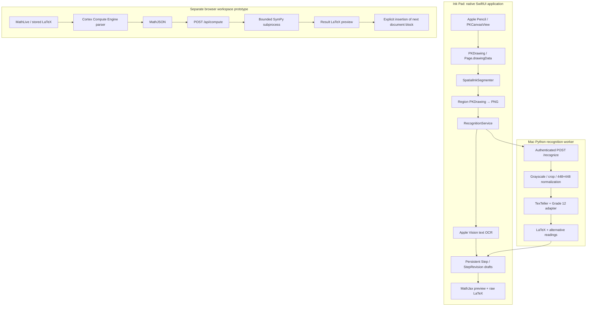

# Folio / Ink Pad — Technical Architecture and Implementation Audit

**Prepared for:** architectural review and technical planning in a new ChatGPT conversation.  
**Report date and verification refresh:** November 2, 2026.  
**Earlier source inspection:** October 29, 2026, refreshed against the current implementation.  
**Repositories:** `ink-pad` and `folio-ipad-labs`, both accessible.  
**Base commits:** `ink-pad`: `b4cf870`; `folio-ipad-labs`: `63d145b`.

Both working trees contain uncommitted changes and untracked implementation files. This report describes the inspected **working trees**, not the base commits alone. Another checkout at those commits will not necessarily contain the implementation described here.

## Reading this report

- **Implemented:** supported by inspected source; not automatically a claim of successful runtime behavior.
- **Verified in this audit:** metadata inspection or a lightweight check actually performed for this report.
- **Historical test evidence:** an existing execution log or result artifact was inspected; the test was not necessarily rerun against today's exact working tree.
- **Recorded claim:** documented results whose underlying raw artifacts are absent.
- **Architectural inference:** a consequence or risk inferred from code, not a reproduced physical-device failure.
- **Proposed:** future work; no implementation is implied.

Source references include file names, entry points, and line numbers. Links use paths relative to this report. `I` means the Ink Pad native source directory `../ink-pad/inkpad/inkpad/`; `L` means this repository, `folio-ipad-labs/`. References remain useful as file/line locators if a Markdown viewer does not support `#L...` anchors. A source index appears at the end.

**Audit constraints:** only this report was created. No project source, configuration, model, or dependency was modified. No dependencies were installed, no models were downloaded, no training or model conversion was performed, and no expensive recognition benchmark was run. Fresh verification used the existing Python environment with bytecode writing disabled and in-memory computation. No new Xcode build or simulator run was started for this report.

## 1. Executive summary

Folio has a native **ink capture and recognition-preview path** and a separate, more capable **browser symbolic-mathematics prototype**. These have not yet been joined into a native handwritten solving workflow.

1. **Ink Pad preserves original PencilKit drawings.** It stores serialized drawings in SwiftData pages and derives expression regions automatically. Its grouping algorithm uses spatially connected stroke bounding boxes, not mathematical grammar. [CanvasView.swift:7][I01], [InkSegmentationService.swift:18][I04], [Page.swift:5][I05]
2. **TexTeller inference runs on the Mac.** The iPad sends region PNGs to a Python HTTP worker and receives LaTeX and alternatives. The model is not downloaded to the iPad by connecting to the endpoint. Apple Vision is a separate, on-device text-OCR option and remains the default provider when no preference exists. [RecognitionConnection.swift:4][I09], [local_ocr.py:97][L01]
3. **Native recognition results are persisted drafts, not accepted mathematics.** The preview exposes copying, but not an authoritative edit/accept workflow. Separate Mac and browser prototypes do have correction/acceptance code. [RecognitionPreviewView.swift:12][I10], [StepTrackingCoordinator.swift:107][I08], [prototype Notebook.swift:112][L20]
4. **There is no native mathematical IR or real solving connection.** Native `Step` objects contain ink snapshots and strings. The native `MathEngine` is a mock. [Step.swift:6][I06], [MathEngine.swift:3][I16]
5. **The browser prototype has real parsing, computation, and insertion code.** It parses LaTeX with Cortex Compute Engine, sends MathJSON to a whitelist-based SymPy adapter, previews returned LaTeX, and inserts a new document block explicitly. This is not integrated Ink Pad functionality. [MathEditor.tsx:8][L09], [App.tsx:429][L10], [engine.py:14][L07]
6. **The integrated model is smaller than Uni-MuMER.** Header inspection verified 298,101,248 stored FP32 base weight elements and 761,856 adapter elements. The larger Uni-MuMER research model is not the native provider. [local_ocr.py:26][L01], [adapter configuration][L03], [eval_unimumer.py:59][L25]
7. **Testing evidence is stronger than physical-handwriting evidence.** Historical logs support 22 native simulator tests, 16 worker tests, and a subsequent rerun of the six recognition tests. These do not establish Apple Pencil recognition accuracy. [native execution log][E01], [worker execution log][E02], [later recognition log][E03]
8. **Training claims are not fully auditable from this checkout.** The scripts and adapter exist, but generated training manifests, loss reports, and full evaluation outputs are missing. Reported fine-tuning improvements must remain labeled as recorded claims.

The most useful next decisions concern real-device quality measurement, correctable region membership, reviewed expressions, and the parsing/computation boundary. On-device TexTeller deployment is a separate feasibility investigation.

## 2. Verified current architecture

### 2.1 End-to-end data flow



There is **no implemented arrow** from native `Step` to the browser computation pipeline. Stroke Lab is also separate from automatic notebook recognition, even though it is reachable from the same application's library.

### 2.2 Pipeline inventory

| Stage | Actual implementation | Input → output / data format | Dependencies | Limitations |
|---|---|---|---|---|
| Apple Pencil capture | Native `CanvasView` / delegate | PencilKit events → `PKDrawing` | UIKit, PencilKit, device input | Live Pencil quality is not benchmarked here |
| Stroke storage | Native `Page`, `Step`, `StepRevision` | PencilKit serialized `Data`; SwiftData objects | Persistent SwiftData container | Most save errors are suppressed; no reviewed-expression state |
| Region detection | Native `SpatialInkSegmenter.regions` | Drawing bytes → `[InkRegion]` with bounds and stroke fingerprints | CPU / main application flow | Fixed spatial thresholds; no mathematical layout model |
| Image generation | Native `RowInkRenderer.renderPNG` | Region drawing bytes → opaque white PNG | UIKit/PencilKit rasterization | Final pixel bound does not cap every intermediate allocation |
| Model preprocessing | Mac `decode_image` / `preprocess` | PNG data URL → float tensor `[1,1,448,448]` | Pillow, NumPy, Torch | Base-model training preprocessing parity not independently established |
| Model inference | Mac `Recognizer.recognize` | Tensor → generated token IDs | Cached TexTeller, PEFT adapter, MPS or CPU | Single serving slot; no inference wall-clock deadline |
| LaTeX / candidates | Mac cleanup; native mapping | Token IDs → primary LaTeX and alternatives | RoBERTa tokenizer; JSON | No semantic candidate ranking or calibrated confidence |
| Typesetting | Native `MathJaxWebView` | LaTeX strings → SVG in a web view | WebKit; bundled MathJax | Rendering does not establish syntactic or semantic correctness |
| Mathematical parsing | Browser only | LaTeX → transient MathJSON | Cortex Compute Engine | No connected native parser; supported engine subset is narrower than parser vocabulary |
| Symbolic commands | Browser Python backend only | Validated MathJSON + command → SymPy result | SymPy subprocess | Not connected to Ink Pad; no general derivation output |
| Result insertion | Browser only | Result LaTeX → new `math` block | React document state / persistence | No native result object, canvas layout, or command transaction |

Sources: [I01], [I05], [I07], [I08], [I09], [I11], [L01], [L07], [L08], [L09], [L10], [L11].

### 2.3 Separate prototypes that must not be conflated

- **Mac native workspace:** its own `InkDocument`, `AcceptedExpression`, undo snapshots, geometric `ShadowNode`, correction field, and atomic JSON writer. Its image renderer and region grouping differ from Ink Pad's. [L19], [L20], [L21], [L22]
- **Browser workspace:** stores LaTeX-based document blocks, supports structured keyboard mathematics, computation previews, and explicit insertion. Its optional handwriting transcription endpoint uses Gemini, not the native TexTeller client path. [L08], [L09], [L10], [L11], [L12]
- **Stroke Lab:** manual annotation and portable capture packages with explicit stroke membership. There is no inspected connection from its groups to `SpatialInkSegmenter`. [I14], [I15]
- **HME experiments:** Uni-MuMER and pix2tex evaluation scripts, not live native providers. [L25], [L26], [L27]

## 3. Stroke grouping analysis

### 3.1 Capture and storage

`CanvasView.makeUIView` creates a `PKCanvasView`, assigns a delegate, initializes its drawing, selects its tool, and gives it a 1024 × 2048-point content area. Drawing policy is Pencil-only on physical devices unless finger input is enabled; simulator state defaults to permitting finger input. `canvasViewDrawingDidChange` forwards the entire current drawing to `CanvasViewModel.drawingChanged`. [I01:7,58][I01], [I02:44,90][I02]

`drawingChanged` updates the in-memory drawing, sends serialized drawing data immediately through `onDrawingChanged`, and starts a separate one-second autosave timer. In `NotebookView`, the immediate callback updates `Page.drawingData`; the save callback invokes `modelContext.save()`. [I02:90,117][I02], [I12:445][I12]

**Raw ink preservation:** the canonical notebook drawing is PencilKit serialized data, not a screenshot. Region snapshots and revision snapshots also retain drawing data. This supports access to the underlying stroke paths and their metadata, subject to PencilKit's representation. It is not a claim that the application currently uses all that metadata. [I05], [I06], [I07]

### 3.2 Coordinates, timestamps, ordering, and pressure

`PKStrokeProvider.strokes` exposes each path's point location, force, and `timeOffset`, in stroke/path array order. It does not transform coordinates through `stroke.transform` and does not return creation dates, azimuth, altitude, masks, or brush properties. Thus its coordinates are not necessarily page-space coordinates for transformed strokes. [I03:13][I03]

Stroke Lab's portable exporter is more complete. It exports point time, pressure, azimuth, altitude, width, height, opacity, ink properties, creation time, transform, render bounds, and random seed. The package retains both JSON and the original `drawing.pkdrawing`. Portable export explicitly rejects masked strokes rather than silently exporting erased point geometry as visible ink. [I14:23,90][I14]

Ordering and per-path time offsets remain available; automatic region ordering is spatial, not temporal. This audit did not measure timestamp or pressure accuracy on the physical Pencil device.

### 3.3 Automatic mathematical-region assignment

`SpatialInkSegmenter.regions` decodes the drawing, excludes marker/highlighter strokes, compares every pair of remaining stroke render bounds, and uses a disjoint-set structure to form connected components. Each component becomes an `InkRegion` containing a `PKDrawing` of its strokes. [I04:22][I04]

The pairwise rules in `shouldGroup` are:

- Intersection after expanding one stroke bound by eight points.
- Same-line grouping: vertical overlap at least 25% of the smaller height and horizontal gap at most 48 points.
- Stacked grouping: horizontal overlap at least 30% of the smaller width and vertical gap at most 24 points.

There is no pen-up timing feature, temporal-proximity rule, writer-scale model, bracket detector, matrix-grid model, or mathematical grammar. Connectivity is transitive: A touching B and B touching C makes one region even if A and C would not match directly. Pairwise work is quadratic in stroke count. [I04:27,67][I04]

### 3.4 The approximately 650 ms delay

`NotebookView.scheduleRecognition` updates a revision UUID and maintains one processing task. The task sleeps 650 ms, checks whether the revision changed, and repeats until a stable iteration. It then calls `StepTrackingCoordinator.process`. [I12:476][I12]

The delay primarily schedules recognition, but it is **not a complete grouping debounce**: the drawing-change callback already invokes `SpatialInkSegmenter.regions` immediately to mark stale results. There is also a separate one-second autosave debounce. The old combined autosave-plus-recognition delay is not the current implementation. [I12:455][I12], [I02:117][I02]

This loop does not guarantee execution exactly 650 ms after the last stroke. Scheduling, the polling phase, existing inference, and processing of other regions affect latency. It processes regions sequentially in their spatial order.

### 3.5 Adding, deleting, moving, and modifying strokes

`StepTrackingCoordinator.process` matches new regions to existing inferred steps using the larger of shared fingerprint overlap and bounding-box intersection-over-union. Scores below 0.15 are excluded. If the best two candidates are within 0.1, grouping is considered ambiguous and inference is skipped for that region. Unmatched old steps are marked inactive, not deleted. [I08:32,182][I08]

- **Add strokes:** a component may expand; the associated step is updated if matching succeeds.
- **Delete strokes:** a component may shrink, split, or disappear. Removing all drawing strokes deactivates displayed inferred steps immediately; other deletions are reconciled during processing.
- **Move strokes:** bounds and fingerprints change. A sufficiently distant move can lose the old step association because both similarity inputs can fall to zero.
- **Modify strokes:** affected regions should become stale, but invalidation depends on the sparse region fingerprint described below.
- **Split/merge:** inferred identities are reassigned heuristically. There is no explicit lineage model for one region becoming several or several becoming one.

These are source-derived behaviors. They were not all exercised physically during this audit.

### 3.6 Fingerprint limitations

The per-stroke fingerprint combines rounded bounds, point count, and only the first, middle, and last point coordinates. It does not hash the complete visible stroke, all interior points, color, force, or masks. Distinct edits can therefore share a region fingerprint. [I04:86][I04]

The full-page drawing fingerprint does hash serialized drawing bytes and helps reject stale responses. However, after a page change, an individual region can still be classified as unchanged if its sparse fingerprint matches and its state is not marked for reprocessing. This is a concrete invalidation risk supported by the code; it is not a reproduced user-handwriting failure. [I04:58][I04], [I08:69,177][I08]

### 3.7 Manual selection and special notation

The main notebook supplies PencilKit's lasso tool, but the inspected bridge does not expose its selection as a mathematical `InkRegion`. `selectedStrokesBounds` exists for overlays, but no producer was found in `CanvasView`. There is no connected notebook workflow to correct region membership, split regions, or merge regions. [I01], [I02:64][I02], [I12]

Stroke Lab does implement stroke-list selection, assignment/unassignment, split/merge, and nested visual-row annotations. These tools operate on separate annotation packages. [I15:110,183,223][I15]

| Notation | Automatic notebook treatment |
|---|---|
| Fractions | Generic overlap/stacked connectivity, not a fraction parser |
| Superscripts/subscripts | Generic nearby bounds; no script-specific semantics |
| Integral signs, limits, differentials | No special handling |
| Matrices and bracketed arrays | No bracket/grid-aware grouping |
| Multiline expressions | No semantic multiline representation |
| Adjacent independent expressions | May connect through spatial chains |

**Plausible architectural failures, not physically reproduced:** large detached scripts splitting; matrix rows separating; nearby equations merging; long fraction bars joining unrelated material. The Mac prototype's scale-dependent grouping and limited fraction parsing do not apply to this native algorithm. [L19:45][L19]

## 4. TexTeller recognition analysis

### 4.1 Exact model and architecture

The worker pins `OleehyO/TexTeller` at revision `7b96df06b9d81cdb129c3bef68b7250bc3e2b0ea`. The `grade12` profile identifies adapter `grade12-pilot-500`; direct construction of `Recognizer()` defaults to the base model for comparisons, whereas service startup defaults to `grade12`. [L01:26,80,97,138][L01], [L02]

Read-only inspection of the cached configuration and safetensors headers on November 2 verified:

| Property | Verified value |
|---|---|
| Vision encoder | ViT, one input channel |
| Encoder hidden dimension / layers / heads | 768 / 12 / 12 |
| Encoder image / patch size | 448 / 16 |
| Text decoder | TrOCR, cross-attention enabled |
| Decoder dimension / layers / heads | 1024 / 12 / 16 |
| Decoder feed-forward dimension | 4096 |
| Vocabulary / maximum positions | 15,000 / 1,024 |
| Base stored weight elements | 298,101,248 |
| Base stored dtype | FP32 |
| Base safetensors file | 1,192,464,688 bytes |
| Adapter stored weight elements | 761,856 |
| Adapter dtype / tensor count | FP32 / 96 tensors |
| Adapter safetensors file | 3,061,656 bytes |

The cached configuration is outside the repositories at `~/.cache/huggingface/hub/models--OleehyO--TexTeller/snapshots/7b96df06b9d81cdb129c3bef68b7250bc3e2b0ea/config.json`. Weight counts describe stored tensors, not measured process memory. No model was initialized to obtain these figures.

### 4.2 Base weights and adapter

`adapter_spec` checks the configured base identity and verifies both adapter files against SHA-256 hashes. `Recognizer.__init__` loads the base with `local_files_only=True` and safetensors, then wraps it with `PeftModel.from_pretrained(..., is_trainable=False)`. It calls evaluation mode and enables decoder caching. There is no adapter merge operation in the serving path. [L01:80,99][L01]

The adapter configuration has rank 8, alpha 16, dropout 0.05, no bias adaptation, and `q_proj`/`v_proj` targets. Inspected tensor names include decoder self-attention and encoder-cross-attention projections. [L03]

### 4.3 Image generation and preprocessing

The native renderer crops a region to its drawing bounds expanded by 16 points, renders against white, and encodes PNG. Final output scale is the smaller of 2 and a scale calculated for approximately 1.5 million pixels. **The intermediate `drawing.image(..., scale: scale)` still uses the original requested scale**, so the final cap is not a bound on every intermediate allocation. [I07:54][I07]

The worker validates the PNG data URL and signature, limits decoded images to two million pixels, flattens transparency onto white, and converts to grayscale. It finds the ink bounding box using a greater-than-15 difference from white, tightly crops it, and resizes proportionally so the longest edge is 448 pixels. Small inputs are upscaled. Bicubic resampling is used. [L01:31,47][L01]

Normalization is:

```text
(grayscale_pixel / 255 - 0.9545467) / 0.15394445
```

The resized image is placed at the top-left of a zero-filled `[1,1,448,448]` float32 tensor. Zero padding is in normalized space, not necessarily equivalent to an unnormalized white pixel. [L01:58][L01]

**Verified preprocessing parity:** local adapter training imports and calls the same `preprocess` function. **Unverified parity:** the base model's original upstream training preprocessing was not established from source available here; no `preprocessor_config.json` is present in the inspected cached snapshot. [L13:14,41][L13]

**Actual distribution difference:** default eligible adapter examples are rendered typeset glyphs plus small rotations. Native PencilKit glyph shape, spacing, brush width, force effects, colored ink, and layout can differ. Matching tensor normalization does not establish handwriting-distribution parity. [L16], [I02]

### 4.4 API and transport

The native client sends JSON to `POST /recognize`:

```json
{"image":"data:image/png;base64,...","mode":"math"}
```

The server additionally accepts `mode: "numbers"`, which filters generated candidates. Ink Pad currently sends `"math"` for all native math modes; those UI modes are not transmitted as calculus/linear-algebra/proof specializations. [I09:86][I09], [L01:180][L01]

Representative response schema:

```json
{
  "latex":"x^{2}+3x=7",
  "alternatives":["..."],
  "note":"Local model draft. Review before accepting.",
  "seconds":0.592,
  "provider":"TexTeller",
  "device":"mps",
  "profile":"grade12",
  "adapter":"grade12-pilot-500"
}
```

The native response decoder reads only `latex` and `alternatives`. The UI's duration is measured by the client and includes rendering/request/retry time; worker `seconds` starts after input preprocessing. They are not the same metric. [I09:86,102][I09], [L01:118][L01]

The normal launcher binds to localhost. Explicit LAN mode binds to all interfaces, requires a token of at least 24 characters, and restricts allowed Host values. It rejects browser Origin headers. Tokens are compared with `secrets.compare_digest`. The native client stores development connection settings in `UserDefaults`, not Keychain. [L01:138,156][L01], [L04], [I09:9][I09]

`start-ipad-ocr` detects the Wi-Fi IPv4 address at startup, supports an address override, and allows a stable `.local` hostname. It does not continuously reconfigure a running worker after a network change. The existing app URL is not updated automatically. Debug permits local HTTP; Release client code requires HTTPS, while the provided development launcher itself supplies HTTP. [L05], [I09:27][I09], `../ink-pad/inkpad/Info.plist:5`, `../ink-pad/inkpad/inkpad.xcodeproj/project.pbxproj:401`.

### 4.5 Tokenization, generation, and candidates

The worker uses `RobertaTokenizerFast` with the pinned model revision. Cached metadata identifies RoBERTa-style BOS/EOS/PAD tokens. Generation sets:

```text
max_new_tokens=192
num_beams=3
num_return_sequences=3
do_sample=False
use_cache=True
```

Outputs are decoded in beam-output order, cleaned, and deduplicated by exact string. Candidates without an EOS token are excluded. The native client also deduplicates exact strings and retains at most three, including the primary reading. No sequence scores or calibrated probabilities are returned. [L01:106,122][L01], [I09:108][I09]

Alternatives are not guaranteed to be semantically different. The stored smoke artifact includes both `x^{2}+3x=7` and `x^2+3x=7`, as well as plausible wrong readings. [E04]

### 4.6 Validation, repair, and review

Cleanup trims whitespace, removes surrounding math delimiters, and escapes unescaped percent symbols. Numeric mode applies a restricted token/character filter. There is no full LaTeX parser, brace-balance check, semantic validation, or correctness repair. An EOS-terminated sequence is not proof of valid LaTeX. MathJax rendering success is also not proof of correct recognition. [L01:64,74][L01]

TexTeller returns no calibrated confidence. Native mapping sets confidence to `nil`; the persistent step's nonoptional field receives zero and the state becomes `.ambiguous`. Native users can copy alternatives but cannot edit/accept one as authoritative mathematics. [I09:108][I09], [I08:114][I08], [I10]

### 4.7 Runtime, caching, timeouts, and cancellation

- Service startup loads one recognizer; it does not reload weights for every request.
- Device selection is MPS when available, otherwise CPU; no CUDA selection exists in this worker.
- The serving code performs no explicit FP16 cast; stored weights and input tensors are FP32.
- A 16-entry LRU cache keys predictions by input data URL and mode.
- One inference runs at a time per service process; busy responses are HTTP 503.
- The client retries 503 with waits of one, two, and three seconds.
- Recognition requests have a 90-second timeout; health requests have a five-second timeout.
- Client cancellation does not stop Torch inference. The server shields its inference task and retains the busy slot until the task completes.
- The worker has no explicit inference deadline, peak-memory budget, or allocator telemetry. Runtime memory and sustained thermal behavior are unmeasured.

Sources: [L01:97,117,138,191][L01], [I09:58,65,94][I09].

## 5. Training and benchmark findings

### 5.1 Available and missing artifacts

Present: dataset generation, rendering, training, audit, and evaluation scripts; adapter weights/configuration; checksum manifest; historical documentation; a two-example serving smoke artifact.

Absent on November 2: `experiments/folio-workspace/artifacts/`, generated training manifests/images, `training-report.json`, raw baseline/candidate benchmark outputs, native handwriting fixtures, the full `data/mathwriting-2024/` dataset, and HME baseline result JSON files.

Consequently, this audit can verify **what the scripts do**, not the full provenance or exact performance of the deployed run. Reported accuracy below is explicitly segregated from verified results.

### 5.2 Dataset source and counts

`catalog.py` defines 91 original notation families. The builder defaults imply 2,912 synthetic training expressions, 364 validation expressions, and 364 test expressions. The generator uses one global used-label set to intend exact-expression-disjoint splits. It can import additional MathWriting training-split ink after excluding duplicate labels. The actual imported count cannot be verified without the missing manifest. [L14], [L15]

Documentation says the prepared dataset contained 3,012 train examples: 2,912 synthetic plus 100 public handwriting samples, with 364 synthetic examples in each holdout. That is a **recorded dataset claim**, not a verified manifest count. [L18:5][L18]

The default training filter excludes public handwriting and keeps only `source == "original-synthetic"`. An explicit `--allow-noncommercial-handwriting` option changes that policy. The presence of handwriting in a prepared dataset therefore does not prove it was used for the deployed adapter. [L13:18][L13]

Topics span arithmetic, fractions, comparisons, algebra, equations, inequalities, analytic geometry, polynomials, functions, trigonometry, sequences, probability/statistics, calculus notation, and vectors. Matrices, integration, and complex numbers are labeled extensions. This is notation coverage, not a verified curriculum-completeness or solving dataset. [L15:16][L15]

### 5.3 Synthetic rendering and training

Synthetic images are produced using KaTeX at font sizes 24–36 pixels, with local assets and a white padded background. These are typeset mathematical glyphs, **not synthesized human handwriting trajectories**. [L16:20][L16]

| Training detail | Inspected source behavior |
|---|---|
| Default optimizer steps | 80; a caller can override |
| Default accumulation | Two one-example microsteps per optimizer step |
| Optimizer / learning rate / decay | AdamW / `5e-5` / `0.01` |
| Adapter | Rank 8; alpha 16; dropout 0.05; `q_proj`, `v_proj`; no bias |
| Encoder mode | Explicitly evaluation mode during adapter training |
| Input preprocessing | Same imported function as serving |
| Augmentation | Rotation in approximately ±0.8 degrees; training only |
| Target | Wrapped LaTeX plus EOS; maximum 192 target tokens |
| Gradient clipping | Norm 1.0 |
| Random seeds | 271028 |
| Training loss | Model-supplied supervised loss, recorded each optimizer step |
| Validation loss during training | No validation loop implemented |
| Outputs | Candidate adapter and training report; no automatic deployment |

Source: [train_adapter.py:17][L13].

Documentation identifies the deployed run as 500 optimizer steps seeing 1,000 synthetic examples. The adapter name is consistent with that statement, but **the missing training report prevents independent verification of run steps, exact sample IDs, duration, actual training hardware, or loss values**. No training or validation-loss numbers are invented here. [L18], [L13:53][L13]

### 5.4 Evaluation metrics and split limitations

`evaluate.py` measures first-candidate and top-three matches after limited formatting normalization, grouping counts by family. It saves individual predictions and durations. It does not use algebraic equivalence to turn a wrong transcription into a match. [L17]

The dataset audit checks duplicate labels, cross-split image hashes, missing files, and target length. Its intended splits share template families and rendering styles; they are not writer-disjoint or template-disjoint. The actual generated audit result is absent. Upstream base-model training overlap is also unknown. [L14:23][L14], [L28]

The comparison script explicitly identifies prepared handwriting as an already-used regression set, not a new unseen benchmark. Its referenced candidate and result directories are absent. [L29:29][L29]

### 5.5 Recorded baseline versus adapter results

**These numbers are documentation-recorded claims, not independently verified benchmark results in this audit.** Raw predictions and manifests needed to validate them were unavailable.

| Pipeline | Baseline first / top 3 | Adapter first / top 3 | Evidence |
|---|---:|---:|---|
| Synthetic test, 364 expressions | 187 / 243 | 350 / 354 | Recorded claim |
| Prepared handwriting, 100 images | 67 / 79 | 76 / 88 | Recorded claim |
| Mac prototype native rasterization, 100 stroke samples | 81 / 91 | 82 / 93 | Recorded claim |

Source: [training/k12/README.md:37][L18]. These are different image pipelines and should not be merged into one accuracy figure. The native fixture source imports supplied stroke arrays and rasterizes through the Mac prototype's custom `inkPNG`; it does not demonstrate live users writing with Apple Pencil in Ink Pad. [L21:223][L21], [L22:98][L22]

### 5.6 Existing benchmark scripts and reproducibility gaps

- `training/k12/build.py`, `render.mjs`, `audit.py`, `train_adapter.py`, `evaluate.py`, and `compare.py` provide a reproducible procedure in principle. Missing source data/artifacts must first be recovered or regenerated; nothing was regenerated here.
- `scripts/evaluate-local-ocr.py` can render fonts or MathWriting InkML, call the real HTTP worker, and save crops/predictions. Its request is fixed to unauthenticated localhost; it requires adjustment or the default local-only worker mode when the serving process is configured for authenticated LAN access. [L30:68][L30]
- The separate native prototype can evaluate supplied stroke fixtures, but writes artifacts and uses its own capture/grouping path. [L21:223][L21]
- No reproducible, labeled live Apple Pencil benchmark for the integrated notebook was located.

### 5.7 Uni-MuMER and other HME experiments

Uni-MuMER is a separate Transformers-based `Qwen3VLForConditionalGeneration` experiment using `phxember/Uni-MuMER-Qwen3-VL-2B`. It supports CUDA/MPS/CPU selection, BF16 outside CPU by default, image-plus-prompt processing, and greedy decoding by default. Its configuration uses the first 200 MathWriting validation samples, height-128 rendering, stroke width 3, and up to 1,024 output tokens. It is not connected to Ink Pad. [L25], [L26]

The shared HME metrics implement normalized token exact match, tolerance within one/two token edits, BLEU-4, and normalized token edit distance. These differ from the TexTeller script's first/top-three limited string-normalization metrics. [L27]

| HME experiment | Documentation-recorded outcome | Current verification boundary |
|---|---|---|
| pix2tex | 0% exact match on the reported handwriting sample | Evaluation code exists; raw run JSON absent |
| Uni-MuMER | 41% normalized exact match, 46.5% raw-label exact match on 200 validation samples | Configuration/code inspectable; run data/results absent |

Source: [HME README:12][L31]. These values should not be compared directly with the Grade 12 synthetic test or native handwritten regression counts. No new HME evaluation was run.

## 6. Mathematical IR and parsing

### 6.1 Representation by subsystem

| Subsystem | Actual representation | Mathematical IR status |
|---|---|---|
| Ink Pad notebook | `PKDrawing`, `Step`, LaTeX/text, bounds, fingerprints, revisions | No semantic math AST |
| Stroke Lab | Stroke IDs, expression membership, nested visual-row annotations, annotation history | Structural capture annotations, not mathematical semantics |
| Mac native prototype | `ShadowNode.symbol`, `.ink`, `.row`, `.fraction`, `.hole` | Limited draft geometric tree, not a general solver IR |
| Browser workspace | Stored LaTeX blocks; transient Cortex MathJSON at operation time | Implemented parsing boundary |
| Python engine | Whitelisted MathJSON → SymPy objects | Implemented symbolic representation |

Sources: [I06], [I14], [I15], [L19], [L09], [L07].

### 6.2 LaTeX-to-MathJSON implementation

The browser's `mathJSON` rejects empty input, caps source length at 5,000 characters, lazily creates Cortex Compute Engine, calls `parse(latex)`, checks `expression.isValid`, and returns `expression.json`. MathLive is the editor; KaTeX is the browser preview renderer. Declared dependencies include Cortex Compute Engine `^0.30.2` and MathLive `^0.111.1`. [L09:8][L09], `L/experiments/folio-workspace/package.json:18`.

This parser was not executed in the current verification refresh because `node_modules` is absent. The existence of the parser call does not establish its exact output for arbitrary TexTeller LaTeX.

### 6.3 Supported mathematical structures

The Python decoder accepts finite bounded numbers, restricted numeric objects, simple symbol names, selected constants, arithmetic, powers, roots, selected elementary functions, equality, lists/tuples, rectangular matrices, and a delimiter wrapper. Its accepted vocabulary is narrower than a general LaTeX parser's vocabulary. [L07:14][L07]

| Construct | Current engine treatment |
|---|---|
| Matrices | Explicit `Matrix` with rectangular row lists; at most 8 × 8 |
| Equations | `Equal` becomes SymPy `Eq(..., evaluate=False)`; no equation-solving command |
| Derivatives | `derivative` command exists; derivative AST node is not decoded |
| Integrals | `integral` command accepts an integrand; integral AST node is not decoded |
| Implicit multiplication | Must first be interpreted by the LaTeX parser; `Multiply` is supported |
| General functions / inequalities | Not generally supported by the decoder |
| Ambiguous handwriting | No native semantic disambiguation or parse-based candidate ranking |

### 6.4 Concrete verified transformations

Direct engine checks performed in-memory on November 2 confirmed:

```text
["Multiply", 2, "x"] + operation "integral"
    → plain: x**2 + C
    → LaTeX: x^{2} + C

["Power", "x", 3] + operation "derivative"
    → plain: 3*x**2
    → LaTeX: 3 x^{2}

["Matrix", ["List", ["List",1,1,3], ["List",2,-1,0]], "'[]'"]
    + operation "rref"
    → Matrix([[1,0,1],[0,1,2]])
```

These verify the **MathJSON-to-engine** boundary, not a fresh LaTeX-parser round trip. The earlier source audit also inspected equality and exact-rational decoder behavior. In the refresh, representative `Integrate`, `D`, `Less`, and `Function` nodes were explicitly rejected as expected. [L07]

### 6.5 Meaning, alternatives, correction, and round trips

- Parser validity establishes recognized syntax, not agreement with the writer's intended problem.
- Recognition alternatives are not independently parsed or ranked by parse validity.
- Browser users can edit malformed expressions in MathLive and retry; native preview users cannot authoritatively correct the associated `Step`.
- The browser persists original LaTeX, not a canonical MathJSON document. MathJSON is generated at the computation boundary.
- SymPy can simplify or canonicalize notation, so returned LaTeX need not reproduce the input exactly.
- No lossless LaTeX ↔ MathJSON round-trip contract or original-meaning test suite was found for the native recognition outputs.

The missing bridge is not simply a network call: it includes reviewed source identity, a supported parser, command-specific interpretation, and explicit error handling for unsupported structures. In particular, a recognized `\int x^2\,dx` is not automatically the integrand `x^2` plus variable `x` expected by the current operation.

## 7. Symbolic computation engine

### 7.1 API and output contracts

The browser backend exposes `POST /api/compute`. Its Pydantic request includes `operation`, `expression`, `variable` defaulting to `x`, optional `other`, and row-operation fields (`row_action`, `row_from`, `row_to`). Row indices use a one-based API convention. [L08:46][L08]

```json
{
  "operation":"integral",
  "expression":["Multiply",2,"x"],
  "variable":"x",
  "other":null,
  "row_action":"add",
  "row_from":1,
  "row_to":2
}
```

Ordinary results contain `latex`, `plain`, and `note`. Equivalence checking instead returns `equivalent` and `note`. Neither result contract provides a structured derivation or a general result MathJSON AST. [L07:192,208,216][L07]

### 7.2 Major commands: actual expected inputs and outputs

For compactness, `M(rows)` below means `['Matrix',['List',...row lists],"'[]'"]`; scalar formulas in the table are supplied as the supported operator-array MathJSON, not executable strings. All ten rows were freshly executed and asserted against the actual engine for this report.

| Command | Example input / extra fields | Actual `plain` result or result flag |
|---|---|---|
| `rref` | `M([[1,1,3],[2,-1,0]])` | `Matrix([[1, 0, 1], [0, 1, 2]])`; rank 2 note |
| `matmul` | `M([[1,2],[3,4]])`, `other=M([[2],[1]])` | `Matrix([[4], [10]])` |
| `rowop` | `M([[1,2],[3,4]])`, add −3 × row 1 to row 2 | `Matrix([[1, 2], [0, -2]])` |
| `derivative` | `['Power','x',3]` | `3*x**2` |
| `integral` | `['Multiply',2,'x']` | `x**2 + C` |
| `simplify` | `sin(x)^2 + cos(x)^2` | `1` |
| `expand` | `(x+1)^2` | `x**2 + 2*x + 1` |
| `factor` | `x^2-1` | `(x - 1)*(x + 1)` |
| `substitute` | `x^2+1`, `other=3`, variable `x` | `10` |
| `check` | `(x+1)^2`, other `x^2+2*x+1` | `equivalent: true` |

RREF returns bracketed matrix LaTeX; differentiation of `x^3` returns `3 x^{2}`; integrating `2x` returns `x^{2} + C`. These are actual outputs, not proposed formats. [L07:133][L07]

The implemented names are `integral` and `derivative`. The requested aliases `/integrate` and `/differentiate` are not implemented native commands. No native handwritten slash-command recognizer is connected.

### 7.3 Validation and mathematical limitations

The decoder uses explicit cases. Limits include payload length 24,000 characters, depth 32, per-node arguments 100, restricted symbols/numeric formats, finite values, bounded numerical powers, exact-number bit budgets, expansion estimates of at most 2,000 terms, matrices of at most eight rows/columns, rectangular rows, and result LaTeX at most 20,000 characters. [L07:14,93,118][L07]

- Integration accepts scalar integrands, not equations or matrices; it returns indefinite antiderivatives, not bound evaluation. A still-unevaluated integral causes an error. The integration constant avoids collision with existing names.
- Differentiation rejects complete equations rather than silently differentiating their sides.
- `rowop` supports swap, nonzero rational scaling, and addition of a rational multiple of a different row.
- Matrix multiplication validates dimensions.
- Symbolic RREF warns that pivot assumptions may require nonzero conditions.
- Equivalence checks expressions or compatible matrices, not full equations. It means equivalence where both expressions are defined. `false` means equivalence was not established, not a proof that the expressions differ everywhere.
- There is no general equation-solving, theorem-proof, assumption-management, or pedagogical derivation API.

### 7.4 Timeouts, resources, execution safety, and determinism

The API uses four concurrent computation slots and starts a subprocess for each request. It applies an eight-second timeout to subprocess communication and kills a timed-out child. The engine entry point attempts a five-second soft and six-second hard CPU limit. [L08:56][L08], [L07:219][L07]

Important limits to those guarantees:

- Waiting for the concurrency slot is outside the communication timeout.
- No explicit process memory cap is set.
- Direct calls to `compute()` do not receive the subprocess-entry-point CPU limit.
- The HTTP request-body cap is enforced after reading the body; it is not a streaming memory bound in this separate API.

The math payload is not passed to `eval`, arbitrary executable code, or unrestricted string `sympify`. This is a meaningful code-execution boundary, but not a complete adversarial sandbox. There is no LLM or intentional random sampling in these operations. Fixed-version behavior is expected to be repeatable; exact formatting/simplification behavior across library versions is not guaranteed. [L07], [L08:22][L08]

Returned notes describe an operation, not its complete mathematical derivation. RREF does not return the row-operation sequence; individual `rowop` calls describe only the operation requested by the caller.

### 7.5 Native integration requirements — proposed, not implemented

To connect this engine to Ink Pad would require:

1. A reviewed-expression contract with source region identity/revision and authoritative LaTeX.
2. A native-accessible parser and explicit support/rejection for its MathJSON vocabulary.
3. Extraction of integrands, variables, and bounds from written calculus notation; complete matrix-region selection and entry validation.
4. An authenticated computation transport. The separate browser API does not automatically inherit the recognition worker's bearer-token policy and should not simply be exposed as if it did.
5. Native command controls, request/version tracking, and user-visible errors.
6. Persistent computed-result objects linked to source expressions and operations.
7. Result placement beneath source work, save/reopen behavior, and undo/redo transactions.

The existing engine is reusable computation logic; it is not a complete native solving feature.

## 8. Native iPad architecture

### 8.1 Main views, models, and state

| Component | Responsibility |
|---|---|
| `inkpadApp` | Persistent SwiftData model container and application navigation |
| `LibraryView` | Notebook listing/creation/renaming, entry to Stroke Lab |
| `NotebookView` | Canvas state, recognition scheduling, overlays, settings, exports, preview |
| `CanvasViewModel` | Observable tool/drawing state and autosave callbacks |
| `CanvasView` | UIKit/PencilKit bridge |
| `StepTrackingCoordinator` | Main-actor region association, recognition, revisions |
| `RecognitionPreviewView` | Draft LaTeX, typeset preview, alternatives, copying |
| `MathJaxWebView` | WebKit/SVG rendering |
| `StrokeLabSession` | Separate capture/annotation package management |

The application combines SwiftUI `@State`, observable view models/coordinators, and SwiftData `@Model` objects. `Notebook` owns ordered pages; pages own steps, branches, chat threads, snapshots, and insights. [I02], [I05], [I06], [I08], [I12], [I13], [I17]

### 8.2 Persistence and expression lifecycle

`inkpadApp` creates a non-memory-only SwiftData container for notebooks, pages, steps, revisions, branches, chat objects, snapshots, insights, class spaces, and worked examples. Persistent storage is implemented, but restart reliability under failures is not established merely by this declaration. Container creation failure ends in `fatalError`. [I13:6][I13]

`Step` stores a UUID, order, bounds, source drawing bytes, fingerprint, recognized text, LaTeX, confidence, recognition/source states, active flag, timestamps, and revisions. `StepRevision` snapshots ink/text/LaTeX/status. There is no accepted/rejected/reviewed state, semantic AST, or computed-result provenance object. [I06], [I18]

Alternatives and durations are coordinator dictionaries rather than saved fields. Per-step provider, base revision, adapter ID, and request metadata are not persisted. Reopening a notebook therefore does not preserve the full recognition provenance or alternatives. [I08:13][I08], [I06]

`try? modelContext.save()` suppresses persistence failures in the normal notebook path. No explicit versioned migration/recovery policy was found. Existing notebook recognition tests use memory-only containers; disk-reopen tests belong to Stroke Lab's separate package store. [I12:445][I12], [I21], [I23]

### 8.3 Review, undo, and computation

The main recognition preview has no editing or acceptance controls. Its stored text is an automatically saved draft. A chat attachment field named "Recognized LaTeX" is fed through `MockRecognitionService` and sends a chat message; it does not correct the associated native `Step`. [I10], [I19:218,273,332][I19]

PencilKit provides ink-editing facilities, but the main notebook's environment undo manager is not wired into a unified transaction covering recognition and future results. Stroke Lab has explicit ink undo/redo buttons; the Mac prototype has separate snapshot undo. None proves native command-result undo behavior. [I12:7][I12], [I15:161][I15], [L20:64][L20]

The main native math service is a mock, and several radial actions are empty or call mock visualizations. New recognition drafts are correctly assigned mathematical status `.unchecked`; their presence must not be read as mathematical verification. [I16], [I08:122][I08], [I12:501][I12]

### 8.4 Rendering and screen sizes

The current notebook opens a 360-point side pane when available width is at least 900 points, and a bottom sheet below that width. Each displayed expression has a MathJax web view with a fixed 150-point frame, plus separately selectable LaTeX text. [I12:140][I12], [I10:40][I10]

MathJax assets are bundled, copied into an application temporary directory, and loaded with explicit read access. LaTeX travels through JavaScript arguments and is inserted using DOM `textContent`, avoiding direct HTML interpolation in this renderer. Failed rendering leaves the separate raw LaTeX available, but does not create a parser error or block saving the draft. [I11:70][I11]

Large matrices, many simultaneous web views, compact-sheet settings presentation, dynamic type/accessibility, and physical-device performance are not established by the single-rendered-fraction test.

### 8.5 Other concrete architecture issues

- `currentPageIndex` starts at zero; no page-switching assignment was found in the inspected `NotebookView`, despite page creation/model support.
- `CanvasView.updateUIView` changes tool/policy but does not synchronize a later replacement of the view-model drawing into the UIKit canvas.
- Overlay `scrollOffset` is used but not updated by the inspected canvas delegate.
- Region/step drawing data is duplicated into revisions without an explicit pruning policy.
- `MockMathEngine` returns canned content; model declarations and demo UI are not evidence of real tutoring/verification.
- Native LaTeX and Markdown export handlers write literal mock content. PNG/PDF export have drawing-rendering implementations, but computed mathematics is not a native document layer that those exporters could include.

Sources: [I01:25][I01], [I12:10,32,494,524][I12], [I08:209][I08], [I16]. These are source-supported gaps; not every resulting UX problem was reproduced on hardware.

## 9. Testing and validation

### 9.1 Coverage by category

| Category | Actual coverage | Mocks / real components | Verification boundary |
|---|---|---|---|
| Native unit tests | Simple grouping, highlighter exclusion, deterministic fingerprint, text normalization, PNG signature, revisions | Synthetic strokes; stub recognizers/segmenter | Seven tests in `inkpadTests.swift` |
| Recognition integration tests | HTTP mapping, failures, unknown confidence, cancellation/retry, stale output rejection, bundled MathJax | Mock HTTP/model responses; real PencilKit serialization and WebKit rendering | Six tests; does not exercise real inference or full live scheduling |
| Stroke Lab tests | Data fidelity, transforms, save/reopen, identity, reconciliation, split/merge, invalid packages, masks | Real package code; constructed strokes | Nine tests; separate document workflow |
| Worker unit/integration tests | Image validation, preprocessing shape, cleanup, numeric filter, busy/size responses, adapter checks, LAN auth | Fake recognizer and mocked model loading; real HTTP boundary/preprocessing | Sixteen tests; no actual model decoding |
| Symbolic engine tests | Commands, exact arithmetic, matrix limits, errors, unsafe/large inputs | Real SymPy | Test source exists; pytest absent in current environment |
| Browser UI tests | Documents, exports, command flows, keyboard behavior, consent/correction | Some real backend operations; Gemini responses mocked in AI-flow script | Scripts present; browser dependencies absent |
| Native UI target | Application launch and launch-performance template | App launch | No substantive recognition workflow assertions |
| Mac prototype checks | Programmatic arithmetic strokes, worker inference, acceptance, save/undo, real rendering, delayed HTTP responses | Mixed real worker and deterministic network mocks | Source exists; generated prototype artifacts absent |
| Physical iPad | No located reproducible labeled benchmark | Not established | Historical signed-device build attempt timed out |
| Performance | Two serving smoke records and recorded regression claims | Real-model historical smoke; no representative workload | No measured iPad latency/memory/thermal baseline |

Sources: [I20], [I21], [I22], [I23], [L23], [L24], [L21], [L32], [E01]–[E06].

### 9.2 Historical execution evidence

- The inspected full simulator log shows **22 tests passed**: seven baseline, nine Stroke Lab, six recognition tests.
- A later recognition log shows **the same six recognition tests passed**, not six extra unique tests.
- The worker log shows **16 tests passed**, using mocks as described above.
- Historical unsigned Debug and Release iOS builds succeeded. These logs do not establish successful physical installation or execution, nor a fresh Release build after every later edit.
- The historical signed-device attempt timed out waiting to reconnect to the paired iPad Air.

Sources: [E01], [E02], [E03], [E05], [E06].

### 9.3 Real model smoke evidence

The stored serving artifact records generated inputs `2+2=4` and `x^2+3x=7`, correctly returned as `2+2=4` and `x^{2}+3x=7`. Worker durations are 3.628 and 0.592 seconds; request durations are 3.65 and 0.595 seconds. It records `mps`, `grade12`, and `grade12-pilot-500`. [E04]

This is evidence that a real serving configuration produced those two results. It is not a handwriting benchmark, a physical-iPad test, a controlled cold-start measurement, or a general latency guarantee. A later worker log inspected in the earlier session contained successful requests from another LAN address; absent labeled device/session evidence, that is not upgraded to a ground-truthed Apple Pencil benchmark.

### 9.4 Fresh safe checks for this report

Using the existing Python environment with `-B`, without model initialization or new artifacts:

1. Inspected cached configuration and safetensors metadata; refreshed base/adapter element counts, dtypes, and file sizes.
2. Executed and asserted the ten command examples in section 7 against actual SymPy engine results.
3. Verified that representative `Integrate`, `D`, `Less`, and `Function` nodes are rejected.
4. Confirmed missing dataset/artifact directories, missing browser dependencies, and missing pytest.
5. Recorded repository heads and working-tree state; checked report source references.

No claim is made that the full suite was rerun today. No Xcode build, model benchmark, training, download, or conversion was started for this report. Tests that write temporary packages or build artifacts were not rerun under the report-only creation constraint.

### 9.5 Not yet established

Live physical Pencil accuracy; matrix segmentation; correction effort; full notebook relaunch persistence; actual notebook undo transactions; handwriting-to-command execution; large-page responsiveness; long-expression model behavior; calibrated confidence; quantization accuracy; on-device peak memory, latency, battery, and thermals.

## 10. On-device inference feasibility

### 10.1 Evidence-based assessment

TexTeller is a plausible subject for an on-device experiment; it is **not a demonstrated iPad inference solution**. The target iPad Air 5 uses M1 and 8 GB RAM, but total system RAM is not a guaranteed app allocation. Apple specifications are an external hardware reference, not a repository experiment: <https://support.apple.com/en-ca/111887>.

**Experimentally supported:** historical Mac MPS serving smoke; actual local checkpoint metadata; native image capture and rendering code/tests. **Not demonstrated:** conversion, iPad model loading, on-device TexTeller output, or device performance.

### 10.2 Existing code and investigated runtimes

- `shared/export/coreml_export.py` has `export_to_coreml` and `validate_export`, both raising `NotImplementedError`.
- `ios-bridge/ModelRunner.swift` has no model load/inference implementation and returns an empty result.
- `ios-bridge/InkCapture.swift` returns placeholders.
- No implemented TexTeller Core ML/ONNX/MLX execution path was found in the inspected export/runtime code. Mentions of these formats are not conversion results.

Sources: [L33], [L34], [L35].

### 10.3 Encoder and decoder compatibility

**Architectural inference:** the fixed-shape one-channel ViT encoder is a contained first conversion target. This does not prove current graph/operator export or Neural Engine placement.

The autoregressive TrOCR decoder is more involved: causal masks, encoder cross-attention, dynamic token length, cache updates, EOS handling, and three-beam candidate generation need explicit support. Python `.generate()` should not be assumed to become one exported model call. A practical experiment would likely isolate encoder inference and decoder steps, with generation control implemented separately.

Apple provides PyTorch conversion and stateful-model tooling, but exact compatibility with this checkpoint, Torch/Transformers implementation, attention operations, and cache layout remains untested. External primary references: [PyTorch conversion](https://apple.github.io/coremltools/docs-guides/source/convert-pytorch-workflow.html), [stateful Core ML models](https://apple.github.io/coremltools/docs-guides/source/stateful-models.html).

### 10.4 Weight and runtime memory

Based only on 298,101,248 stored base weight elements:

| Representation | Theoretical base weight payload |
|---|---:|
| FP32 | 1,192 MB / approximately 1,137 MiB |
| FP16 | 596 MB / approximately 569 MiB |
| 8-bit | 298 MB / approximately 284 MiB |
| 4-bit | 149 MB / approximately 142 MiB |

These are arithmetic estimates, **not achieved exported sizes or runtime memory**. They exclude adapter handling, metadata/scales, uncompressed tensors, activations, attention caches, workspaces, framework allocation, WebKit, and notebook state. Quantized storage may be decompressed by some backends; smaller files do not establish smaller or faster execution on M1. Apple emphasizes target-specific measurement: [Core ML optimization guidance](https://apple.github.io/coremltools/docs-guides/source/opt-overview.html).

No peak runtime memory measurement is available. Beam search increases decoder work and cache storage over single-candidate greedy decoding. There is no evidence supporting a claim that the model is definitely too large, or that it will definitely meet an interactive budget.

### 10.5 Adapter merging and remaining blockers

The current worker does not merge the adapter. Merging is not mathematically mandatory because low-rank updates can be represented as operations, but folding them into the base weights would be a reasonable first export experiment to avoid a separate PEFT deployment dependency. That merge and any precision change require output-parity and recognition-regression checks.

Unknowns include graph export, supported operators, attention/cache shapes, dynamic dimensions, tokenizer parity, beam-search implementation, FP16/quantized accuracy, compute-unit placement, startup time, peak memory, sustained latency, thermal/battery behavior, model packaging, and app lifecycle management.

Moving recognition to the iPad would **not** automatically move the Python symbolic engine there. Those are separate runtime/deployment decisions.

## 11. Architectural risks

Severity is relative to the intended handwritten recognition-and-solving experience. Inferred risks below are not presented as physically reproduced failures.

| Issue | Evidence | Impact | Severity | Suggested investigation |
|---|---|---|---|---|
| No representative Apple Pencil quality baseline | Constructed/mock tests; no labeled integrated-device artifacts [I20–I23, E04] | Unknown first-reading accuracy and correction burden | High | Measure actual device capture, grouping, and transcription separately |
| Fixed region grouping | Constant spatial thresholds and transitive components [I04] | Incorrect model inputs for matrices, scripts, multiline work | High | Ground-truth stroke membership across writing scales/layouts |
| Sparse invalidation fingerprints | Bounds/count/three samples [I04:86][I04] | Some edits can retain stale recognition | High | Test interior edits, transforms, masks, and repeated shapes |
| No native correction/acceptance | Copy-only preview; auto-persisted drafts [I10, I08] | Unsafe source for downstream computation | High | Design reviewed/stale states and preserve corrections against late responses |
| No native IR/computation bridge | String-based steps; separate MathJSON/SymPy [I06, L07–L11] | Native solving commands unavailable | High | Define parser, supported vocabulary, authenticated command/result contracts |
| Integral structure unsupported | No integral/derivative-node decoder cases; fresh rejection checks [L07] | Recognized written calculus cannot be evaluated directly | High | Specify integrand/variable/bounds extraction and error cases |
| Missing training/evaluation artifacts | Absent artifacts/manifests/loss reports [L13–L18] | Improvements and contamination boundaries cannot be independently checked | High | Recover source data IDs, run configuration, predictions, and environment |
| Save errors hidden | `try? modelContext.save()` [I12:452, I08] | Users may assume persistence succeeded | High | Exercise write failures and true termination/relaunch recovery |
| Heuristic expression identity | Bounds/fingerprint matching [I08:182][I08] | Moves and split/merge can break links to future results/history | Medium–high | Define stable identities and explicit lineage |
| Main-thread full-page grouping | Pairwise grouping in drawing callback [I12:455, I04] | Large drawings can hurt interaction latency | Medium–high | Profile physical-device drawing as stroke count grows |
| No persistent model provenance | Step lacks provider/checkpoint/candidate history [I06, I08:13] | Reopened work is hard to audit | Medium | Define saved recognition provenance and review metadata |
| Stale inference occupies slot | Shielded thread and single busy flag [L01:191][L01] | Rapid edits can delay the current row | Medium | Measure cancellation/coalescing and busy recovery |
| Development-only networking | Manual token/URL, startup-only detection, HTTP launcher [L04, L05, I09] | Connection failures and Release transport mismatch | Medium | Test network changes, sleep/wake, permissions, and deployment transport |
| Incomplete raster memory cap | Intermediate image keeps requested scale [I07:76][I07] | Large regions may allocate more than final pixel limit | Medium | Measure large-region raster peak memory |
| Multiple independent document models | SwiftData, Stroke Lab, Mac JSON, browser blocks [I05, I14, L12, L20] | Prototype features are easy to mistake for integrations | Medium | Decide explicit import/sharing contracts before transferring features |
| Mock exports/coaching | Literal mock text and canned services [I12:524, I16] | User-visible controls can overstate capabilities | Medium | Inventory visible actions and label/demo boundaries |

## 12. Capability matrix

Historical tests and source-only test definitions are distinguished below; the ten direct engine checks were refreshed for this report.

| Capability | Implemented | Tested | Integrated into iPad notebook | Limitations |
|---|---|---|---|---|
| Pencil input | Yes | Constructed strokes; no physical accuracy benchmark | Yes | Real usage quality unverified |
| Stroke preservation | Yes | Stroke Lab fidelity/reopen; notebook mainly in-memory | Yes | Different persistence paths have different evidence |
| Stroke grouping | Yes | Simple synthetic unit cases | Yes | Fixed spatial heuristics |
| Region selection | Partial | Stroke Lab membership tests | Not as authoritative recognition regions | Notebook lasso is not connected to region ownership |
| Manual split/merge | Stroke Lab | Historical unit evidence | No | Separate annotations |
| Image preprocessing | App and Mac | PNG signature/tensor checks | Yes, distributed | Upstream preprocessing parity unknown |
| TexTeller recognition | Mac worker | Two historical real-model examples; boundary mocks | Network client implemented | No on-device model; physical quality unknown |
| Recognition alternatives | Yes | Mock mapping and smoke artifact | Yes | Copy-only; not semantic alternatives |
| LaTeX rendering | Yes | Real bundled MathJax test | Yes | Not parsing or correctness verification |
| Recognition correction | Separate prototypes | Prototype/browser test code | No authoritative native workflow | Chat field is not a Step correction path |
| Recognition acceptance | Mac/browser prototypes | Separate tests/code | No | Native drafts persist without acceptance |
| Mathematical IR | Browser; limited Mac shadow tree | Engine directly checked | No semantic native IR | Representation boundaries differ |
| LaTeX parsing | Browser | Source inspected; not rerun | No | Missing browser dependencies here |
| SymPy integration | Browser backend | Ten direct command checks | No | Separate API/transport |
| Differentiation | Backend | Fresh direct check | No | Command on expression, not written derivative parsing |
| Integration | Backend | Fresh direct check | No | Indefinite integrands; no bounds contract |
| RREF | Backend | Fresh direct check | No | No automatic row-operation trace |
| Matrix multiplication | Backend | Fresh direct check | No | Rectangular matrices, maximum 8 × 8 inputs |
| Equivalence checking | Backend | Fresh direct check | No | Not full equations/domain equality |
| Result insertion | Browser | UI test definitions | No | No native result object/layout/transaction |
| Notebook persistence | SwiftData | Partial historical evidence | Yes | Save errors suppressed; restart recovery not established |
| Unified notebook undo/redo | Partial underlying mechanisms | Stroke Lab/prototype coverage | Not established | No computation/result transaction model |
| On-device text OCR | Apple Vision | Normalization/unit evidence | Yes | Text-oriented baseline |
| On-device TexTeller inference | No | No | No | Export/runtime placeholders |
| Physical-device validation | No located reproducible benchmark | Not established | User testing is not a benchmark artifact | Historical paired-device attempt timed out |

## 13. Recommended milestones

These are **options for discussion**, not implementation commitments. Difficulty assumes familiarity with the current code and excludes collecting external participants or obtaining new training data. No feature work was performed for this report.

### Milestone 1 — Measure the actual Apple Pencil pipeline

- **Accomplishes:** a representative capture → grouping → PNG → inference → preview baseline on the target iPad.
- **Why it matters:** current test passes do not quantify the intended usage, and recognition errors may originate before the model.
- **Builds on:** raw PencilKit preservation, debug images/logs, worker, and Stroke Lab's annotation concepts.
- **Dependencies:** reachable hardware; ground-truth procedure; recorded model/profile and source revisions.
- **Risks:** small/curated samples, test-set reuse, mixing grouping and model mistakes.
- **Success measurement:** at least 100 labeled physical-device expressions across arithmetic, scripts, fractions, integrals, and matrices; separate grouping metrics; first/top-three accuracy; failure rate; cold/warm end-to-end p50/p95 latency; retained source ink and exact input crops. Multi-writer evaluation should be explicit if claimed.
- **Difficulty:** moderate.
- **Precedence:** before strong accuracy claims, model replacement decisions, or quantization conclusions; can proceed alongside milestone 2.

### Milestone 2 — Reviewed expressions and correctable membership

- **Accomplishes:** selecting a region, correcting/choosing its transcription, and explicitly accepting it as input to later operations.
- **Why it matters:** a solver must know which expression the user intended and whether its source has changed.
- **Builds on:** `Step` revisions and Stroke Lab membership mechanisms, without assuming their document models are already compatible.
- **Dependencies:** stable stroke/region identity, ownership rules, review/stale state, undo decisions.
- **Risks:** late recognition overwriting corrections; split/merge ambiguity; competing undo mechanisms.
- **Success measurement:** edit/accept/reopen works; relevant ink edits mark reviewed text stale; cancellation never replaces a correction; undo preserves source ink.
- **Difficulty:** moderate–high.
- **Precedence:** before automatic native solving; can overlap quality measurement.

### Milestone 3 — Define and validate the parsing boundary

- **Accomplishes:** reviewed LaTeX becomes a supported, inspectable mathematical structure suitable for commands.
- **Why it matters:** valid-looking notation is not automatically the intended integrand, matrix, variable, or equation.
- **Builds on:** browser Cortex parsing and the existing MathJSON whitelist.
- **Dependencies:** reviewed-expression contract and parser deployment choice: native, bundled JavaScript, or backend.
- **Risks:** semantic ambiguity, unsupported AST vocabulary, implicit multiplication, calculus-variable/bounds extraction, matrix dimensions.
- **Success measurement:** a corpus with expected structures and explicit rejection cases; recognizable input preview; no silent substitution of a different problem; independent handling of candidate interpretations.
- **Difficulty:** high.
- **Precedence:** required before milestone 4.

### Milestone 4 — Complete integration and RREF workflows

- **Accomplishes:** ink → reviewed expression → command → preview → persistent result beneath source work.
- **Why it matters:** proves the central notebook product behavior instead of another isolated prototype.
- **Builds on:** milestones 2–3 and existing SymPy operations.
- **Dependencies:** authenticated computation transport; native result/provenance objects; layout; source-revision binding; save/reopen and undo.
- **Risks:** stale or misparsed input, misplaced results, confusing a final answer with an instructional derivation.
- **Success measurement:** integrate a supported reviewed scalar expression with explicit variable; reduce a selected reviewed matrix; preserve source ink; reject unsupported notation; insert/save/reopen/undo correctly; keep the operation and source revision attached to the result.
- **Difficulty:** high.
- **Precedence:** after 2–3. Start with final results; verified hints and derivation traces should be distinct later work.

### Milestone 5 — Bounded offline TexTeller feasibility spike

- **Accomplishes:** a measured go/no-go decision for recognition on iPad Air 5.
- **Why it matters:** offline use cannot be inferred from Mac success or model file size.
- **Builds on:** pinned checkpoint, adapter, shared preprocessing, and a reference corpus.
- **Dependencies:** reference outputs, target device, export/runtime tooling and instrumentation.
- **Risks:** encoder/decoder graph compatibility, KV cache, tokenizer/beam parity, quantization accuracy, memory and thermal behavior.
- **Success measurement:** encoder and decoder-step parity; end-to-end recognition comparison; measured startup, warm latency, peak memory and sustained thermals; documented FP16/compression tradeoffs and failed conversions as well as successes.
- **Difficulty:** high and uncertain.
- **Precedence:** after a baseline corpus exists; may be a separate research track and need not block Mac-hosted native solving.

## 14. Open technical questions

1. What first-candidate accuracy, grouping accuracy, and correction effort are acceptable for the target experience?
2. Is the first intended user a single writer or a broad student population? What evidence supports that scope?
3. Which layer owns stable expression identity: raw PencilKit content, Stroke Lab identities, or a new document contract?
4. What happens to accepted text when its ink changes? Does it become stale, require reconfirmation, or remain a separate object?
5. Where should parsing execute, and which exact notation/AST vocabulary must version one support?
6. Does `/integrate` mean integrate a scalar integrand, evaluate a written integral, or both? How are variable and bounds confirmed?
7. How is a complete matrix selected and checked before RREF?
8. Should the next learning feature provide answers, hints, or verified steps? What verifies an instructional trace?
9. How do generated results affect canvas layout, persistence, revision history, and undo/redo?
10. Can missing training manifests, reports, environment versions, raw predictions, and fixture data be recovered?
11. What were the deployed adapter's actual training hardware, duration, sample history, and loss curve? They are not verifiable from current artifacts.
12. What upstream training/evaluation overlap and base-model data provenance need investigation before broader performance claims?
13. Is the target deployment Mac-assisted, remotely hosted, or mandatory offline iPad? These imply different transport/runtime work.
14. What are acceptable iPad startup, warm latency, peak memory, thermal and battery budgets?
15. Which prototype capabilities will be deliberately transferred, and which document/identity contracts will connect them?
16. How will the uncommitted working-tree implementation be captured for reproducible technical review and experiment comparison?

### Handoff summary for the next reviewer

The verified foundation is **preserved ink plus native recognition preview backed by a Mac worker**. The native solving workflow is missing **reliable/correctable expression ownership, user-reviewed mathematical input, semantic parsing, computation transport, and persistent result insertion**. The browser provides reusable computation logic, not an already-integrated iPad solver. Offline TexTeller remains an unproven deployment investigation. Historical regression accuracy claims require their raw artifacts before being treated as independently verified.

For the next discussion, prioritize the desired interaction and evidence needed for one or two milestones. Do not interpret this report as authorization to implement recommendations, retrain the model, expose the browser API to the network, or claim physical-device quality.

### Source index

Paths below are relative to the report's directory. Line numbers identify relevant entry points in the audited working tree, not immutable commit permalinks. `I01:58` in the text means line 58 in the file associated with I01. Historical `.reports` files are local evidence and may not be included in another clone.

| ID | Source file and principal evidence |
|---|---|
| I01 | `../ink-pad/inkpad/inkpad/InkCore/CanvasView.swift:7` — canvas creation; update at 25; delegate at 58 |
| I02 | `../ink-pad/inkpad/inkpad/InkCore/CanvasViewModel.swift:44` — drawing/tool state; change at 90; autosave at 117 |
| I03 | `../ink-pad/inkpad/inkpad/InkCore/StrokeProvider.swift:13` — point/force/time extraction |
| I04 | `../ink-pad/inkpad/inkpad/Services/InkSegmentationService.swift:18` — region algorithm; rules at 67; sparse fingerprint at 86 |
| I05 | `../ink-pad/inkpad/inkpad/App/Models/Page.swift:5` — page drawing and relationships |
| I06 | `../ink-pad/inkpad/inkpad/App/Models/Step.swift:6` — persisted draft model |
| I07 | `../ink-pad/inkpad/inkpad/Services/RecognitionService.swift:6` — result interface; renderer at 54; Vision at 129 |
| I08 | `../ink-pad/inkpad/inkpad/Services/StepTrackingCoordinator.swift:32` — association, inference, stale checks; matching at 182; revisions at 209 |
| I09 | `../ink-pad/inkpad/inkpad/Services/RecognitionConnection.swift:4` — preferences; health at 65; inference at 86 |
| I10 | `../ink-pad/inkpad/inkpad/App/Views/RecognitionPreviewView.swift:12` — draft/candidate UI |
| I11 | `../ink-pad/inkpad/inkpad/App/Views/TypesetPaneView.swift:70` — MathJax web view |
| I12 | `../ink-pad/inkpad/inkpad/App/Views/NotebookView.swift:140` — responsive layout; scheduling at 445; commands at 501; export at 524 |
| I13 | `../ink-pad/inkpad/inkpad/inkpadApp.swift:6` — persistent model container |
| I14 | `../ink-pad/inkpad/inkpad/StrokeLab/StrokeLabDocument.swift:23` — export metadata; package at 90; store at 105 |
| I15 | `../ink-pad/inkpad/inkpad/StrokeLab/StrokeLabView.swift:110` — grouping controls; selection at 223 |
| I16 | `../ink-pad/inkpad/inkpad/Services/MathEngine.swift:3` — mock mathematics boundary |
| I17 | `../ink-pad/inkpad/inkpad/App/Views/LibraryView.swift:14` — library and Stroke Lab entry |
| I18 | `../ink-pad/inkpad/inkpad/App/Models/StepRevision.swift:5` — ink/text/LaTeX snapshots |
| I19 | `../ink-pad/inkpad/inkpad/App/Views/ChatPanelView.swift:218` — separate mock-backed attachment field |
| I20 | `../ink-pad/inkpad/inkpadTests/inkpadTests.swift:14` — seven baseline tests |
| I21 | `../ink-pad/inkpad/inkpadTests/RecognitionIntegrationTests.swift:20` — six integration/rendering tests |
| I22 | `../ink-pad/inkpad/inkpadUITests/inkpadUITests.swift:25` — template launch checks |
| I23 | `../ink-pad/inkpad/inkpadTests/StrokeLabTests.swift:19` — nine portable-capture tests |
| L01 | `experiments/folio-workspace/server/local_ocr.py:26` — model, preprocessing, inference, authenticated API |
| L02 | `experiments/folio-workspace/config/local-ocr-grade12.json:1` — profile/revision/checksums |
| L03 | `experiments/folio-workspace/models/grade12/adapter_config.json:1` — actual LoRA configuration |
| L04 | `experiments/folio-workspace/scripts/start-local-ocr:1` — local-only default and opt-in LAN binding |
| L05 | `experiments/folio-workspace/scripts/start-ipad-ocr:17` — address/hostname discovery and private settings |
| L07 | `experiments/folio-workspace/server/engine.py:14` — MathJSON decoder; operations at 118; subprocess CPU cap at 219 |
| L08 | `experiments/folio-workspace/server/app.py:46` — computation request and subprocess endpoint; Gemini endpoint at 114 |
| L09 | `experiments/folio-workspace/src/MathEditor.tsx:8` — parser, editor, KaTeX preview |
| L10 | `experiments/folio-workspace/src/App.tsx:429` — command request construction |
| L11 | `experiments/folio-workspace/src/App.tsx:455` — next-block insertion; insertion control at 1471 |
| L12 | `experiments/folio-workspace/src/model.ts:1` — browser document format |
| L13 | `experiments/folio-workspace/training/k12/train_adapter.py:17` — training procedure and reporting |
| L14 | `experiments/folio-workspace/training/k12/build.py:13` — synthetic split builder and optional handwriting import |
| L15 | `experiments/folio-workspace/training/k12/catalog.py:16` — notation families |
| L16 | `experiments/folio-workspace/training/k12/render.mjs:20` — KaTeX training image rendering |
| L17 | `experiments/folio-workspace/training/k12/evaluate.py:13` — limited normalization and first/top-three evaluation |
| L18 | `experiments/folio-workspace/training/k12/README.md:5` — recorded data/run claims; results at 37; not raw evidence |
| L19 | `experiments/folio-workspace/native/Sources/FolioCore/Shadow.swift:5` — limited draft tree; different grouping at 45 |
| L20 | `experiments/folio-workspace/native/Sources/FolioNative/Notebook.swift:64` — prototype undo; correction/acceptance at 112 |
| L21 | `experiments/folio-workspace/native/Sources/FolioNative/NativeChecks.swift:23` — prototype integration checks; fixtures at 223 |
| L22 | `experiments/folio-workspace/native/Sources/FolioNative/InkSurface.swift:98` — prototype custom image renderer |
| L23 | `experiments/folio-workspace/scripts/tests/test_local_ocr.py:25` — mocked model/service tests |
| L24 | `experiments/folio-workspace/server/tests/test_engine.py:14` — real symbolic tests and rejection cases |
| L25 | `experiments/hme-recognition/eval_unimumer.py:59` — independent Qwen3-VL evaluation |
| L26 | `experiments/hme-recognition/configs/unimumer.yaml:3` — model and evaluation configuration |
| L27 | `shared/eval/metrics.py:22` — HME token-based metrics |
| L28 | `experiments/folio-workspace/training/k12/audit.py:10` — dataset overlap/token checks |
| L29 | `experiments/folio-workspace/training/k12/compare.py:29` — baseline/candidate runs and caveats |
| L30 | `experiments/folio-workspace/scripts/evaluate-local-ocr.py:25` — InkML/font HTTP evaluator |
| L31 | `experiments/hme-recognition/README.md:12` — recorded HME results; not raw run evidence |
| L32 | `experiments/folio-workspace/scripts/ai-flow.mjs:7` — browser mocked AI/correction flow |
| L33 | `shared/export/coreml_export.py:12` — unimplemented exporter and parity validator |
| L34 | `ios-bridge/ModelRunner.swift:5` — unimplemented Swift model runner |
| L35 | `ios-bridge/InkCapture.swift:6` — placeholder model-input capture helper |
| E01 | `.reports/inkpad-recognition-20261028-225041/inkpad-recognition-final-tests.log:197` — 22-test historical simulator result |
| E02 | `.reports/inkpad-recognition-20261028-225041/inkpad-recognition-worker-tests.log:21` — 16-test historical worker result |
| E03 | `.reports/inkpad-network-fix-20261029-024126/recognition-tests.log:94` — later six-test recognition result |
| E04 | `.reports/inkpad-recognition-20261028-225041/real-worker-smoke.json:1` — two real-model serving samples |
| E05 | `.reports/inkpad-recognition-20261028-225041/inkpad-recognition-signed.log:6` — failed device reconnection |
| E06 | `.reports/inkpad-recognition-20261028-225041/inkpad-recognition-device.log:786` and `inkpad-recognition-release.log:416` in the same directory — unsigned historical build successes |

[I01]: ../ink-pad/inkpad/inkpad/InkCore/CanvasView.swift#L7
[I02]: ../ink-pad/inkpad/inkpad/InkCore/CanvasViewModel.swift#L44
[I03]: ../ink-pad/inkpad/inkpad/InkCore/StrokeProvider.swift#L13
[I04]: ../ink-pad/inkpad/inkpad/Services/InkSegmentationService.swift#L18
[I05]: ../ink-pad/inkpad/inkpad/App/Models/Page.swift#L5
[I06]: ../ink-pad/inkpad/inkpad/App/Models/Step.swift#L6
[I07]: ../ink-pad/inkpad/inkpad/Services/RecognitionService.swift#L54
[I08]: ../ink-pad/inkpad/inkpad/Services/StepTrackingCoordinator.swift#L32
[I09]: ../ink-pad/inkpad/inkpad/Services/RecognitionConnection.swift#L49
[I10]: ../ink-pad/inkpad/inkpad/App/Views/RecognitionPreviewView.swift#L12
[I11]: ../ink-pad/inkpad/inkpad/App/Views/TypesetPaneView.swift#L70
[I12]: ../ink-pad/inkpad/inkpad/App/Views/NotebookView.swift#L445
[I13]: ../ink-pad/inkpad/inkpad/inkpadApp.swift#L6
[I14]: ../ink-pad/inkpad/inkpad/StrokeLab/StrokeLabDocument.swift#L23
[I15]: ../ink-pad/inkpad/inkpad/StrokeLab/StrokeLabView.swift#L110
[I16]: ../ink-pad/inkpad/inkpad/Services/MathEngine.swift#L3
[I17]: ../ink-pad/inkpad/inkpad/App/Views/LibraryView.swift#L14
[I18]: ../ink-pad/inkpad/inkpad/App/Models/StepRevision.swift#L5
[I19]: ../ink-pad/inkpad/inkpad/App/Views/ChatPanelView.swift#L218
[I20]: ../ink-pad/inkpad/inkpadTests/inkpadTests.swift#L14
[I21]: ../ink-pad/inkpad/inkpadTests/RecognitionIntegrationTests.swift#L20
[I22]: ../ink-pad/inkpad/inkpadUITests/inkpadUITests.swift#L25
[I23]: ../ink-pad/inkpad/inkpadTests/StrokeLabTests.swift#L19
[L01]: experiments/folio-workspace/server/local_ocr.py#L26
[L02]: experiments/folio-workspace/config/local-ocr-grade12.json#L1
[L03]: experiments/folio-workspace/models/grade12/adapter_config.json#L1
[L04]: experiments/folio-workspace/scripts/start-local-ocr#L1
[L05]: experiments/folio-workspace/scripts/start-ipad-ocr#L17
[L07]: experiments/folio-workspace/server/engine.py#L14
[L08]: experiments/folio-workspace/server/app.py#L46
[L09]: experiments/folio-workspace/src/MathEditor.tsx#L8
[L10]: experiments/folio-workspace/src/App.tsx#L429
[L11]: experiments/folio-workspace/src/App.tsx#L455
[L12]: experiments/folio-workspace/src/model.ts#L1
[L13]: experiments/folio-workspace/training/k12/train_adapter.py#L17
[L14]: experiments/folio-workspace/training/k12/build.py#L13
[L15]: experiments/folio-workspace/training/k12/catalog.py#L16
[L16]: experiments/folio-workspace/training/k12/render.mjs#L20
[L17]: experiments/folio-workspace/training/k12/evaluate.py#L13
[L18]: experiments/folio-workspace/training/k12/README.md#L37
[L19]: experiments/folio-workspace/native/Sources/FolioCore/Shadow.swift#L5
[L20]: experiments/folio-workspace/native/Sources/FolioNative/Notebook.swift#L112
[L21]: experiments/folio-workspace/native/Sources/FolioNative/NativeChecks.swift#L223
[L22]: experiments/folio-workspace/native/Sources/FolioNative/InkSurface.swift#L98
[L23]: experiments/folio-workspace/scripts/tests/test_local_ocr.py#L25
[L24]: experiments/folio-workspace/server/tests/test_engine.py#L14
[L25]: experiments/hme-recognition/eval_unimumer.py#L59
[L26]: experiments/hme-recognition/configs/unimumer.yaml#L3
[L27]: shared/eval/metrics.py#L22
[L28]: experiments/folio-workspace/training/k12/audit.py#L10
[L29]: experiments/folio-workspace/training/k12/compare.py#L29
[L30]: experiments/folio-workspace/scripts/evaluate-local-ocr.py#L25
[L31]: experiments/hme-recognition/README.md#L12
[L32]: experiments/folio-workspace/scripts/ai-flow.mjs#L7
[L33]: shared/export/coreml_export.py#L12
[L34]: ios-bridge/ModelRunner.swift#L5
[L35]: ios-bridge/InkCapture.swift#L6
[E01]: .reports/inkpad-recognition-20261028-225041/inkpad-recognition-final-tests.log#L197
[E02]: .reports/inkpad-recognition-20261028-225041/inkpad-recognition-worker-tests.log#L21
[E03]: .reports/inkpad-network-fix-20261029-024126/recognition-tests.log#L94
[E04]: .reports/inkpad-recognition-20261028-225041/real-worker-smoke.json#L1
[E05]: .reports/inkpad-recognition-20261028-225041/inkpad-recognition-signed.log#L6
[E06]: .reports/inkpad-recognition-20261028-225041/inkpad-recognition-device.log#L786
