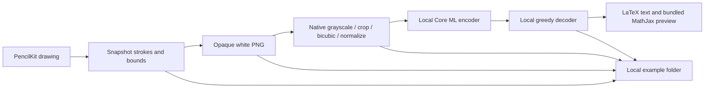

# Pencil → local LaTeX probe checkpoint

2026-11-04. This extends the separate Folio ML Probe, not the main Ink Pad app.
The prior [TexTeller feasibility report](ON_DEVICE_TEXTELLER_FEASIBILITY.md)
describes the model conversion and first physical-device fixture measurements.

## User flow

1. Open **Folio ML Probe**, select **Write**, and draw one expression with Apple
   Pencil (finger drawing also works). Black pen on white is fixed for this test.
2. Optionally enter expected LaTeX before recognition to label the saved example.
3. Tap **Recognize**. The local model loads on first use. A progress indicator and
   cancellation button stay available while preprocessing/inference run.
4. Review the typeset result and selectable/copyable raw LaTeX. The layout uses
   columns at widths of 760 points or more and stacks in narrower windows.
5. Add/erase strokes to try again, or **Clear**. Modifying the drawing removes
   the displayed prediction. Saved examples remain in Files.

The **Fixtures** tab retains the six-image parity test. Both tabs use one model
actor, avoiding two loaded copies of the model. This test has manual recognition;
it does not add the main notebook's grouping or 650 ms debounce.

## Implemented pipeline

`ProbeApp/PencilRecognition.swift` implements the canvas, white-background capture,
background processor, record persistence, results UI and bundled WebKit preview.
`ProbeApp/ImagePreprocessor.swift` implements grayscale/crop/resize/normalization.
`ProbeApp/ProbeApp.swift` contains the shared Core ML generation actor and both
tab roots. `prepare_app.py` stages the previously exported models and existing
MathJax asset/license from the sibling app; it modifies no sibling source.

Recognition snapshots the current drawing, bounds plus 12 points of capture
padding, optional label, and revision. It renders at up to 2 pixels per point,
capping the longest capture edge at 2,048 pixels. The PNG is opaque white; raw
PencilKit data remains separately preserved. Drawing is disabled during a request;
revision and cancellation checks additionally prevent stale output publication.

The native preprocessing reproduces the current worker: foreground difference
from white >15 (gray <240), tight crop, longest edge 448 with integer truncation,
antialiased separable bicubic resampling, mean 0.9545467/std 0.15394445, and
top-left placement in a zero-filled tensor in normalized space. Crop/resize
dimensions are retained in each record. The resize reproduces the reference's
integer coefficient rounding and clipping; it deliberately preserves quirks such
as a longest edge occasionally truncating to 447 because of floating arithmetic.

The Core ML model and weights are unchanged. Encoder/decoder generation is shared
between fixtures and handwriting. Atomic model initialization prevents a partial
load from being reused after a loading error. The decoder remains uncached,
greedy, and capped at 192 new tokens, with EOS required. Cancellation is checked
between model steps; it cannot interrupt a synchronous prediction already running.

Bundled MathJax typesets the output locally. LaTeX is passed via a structured
JavaScript argument; it is never interpolated into executable HTML/script. The
preview disallows network connections and navigation to non-file URLs. Raw LaTeX
stays visible if typesetting fails. The smoke test checks for an actual SVG.

## Saved examples and timing

Each completed recognition writes `Documents/Handwriting/<UUID>/`:

| File | Contents |
|---|---|
| `strokes.drawing` | Raw `PKDrawing.dataRepresentation()`, preserving native strokes |
| `input.png` | Opaque captured region before model preprocessing |
| `input.f32` | Little-endian float32 normalized tensor, shape `[1,1,448,448]` |
| `result.json` | Timestamp, source, stroke count, optional expected LaTeX, crop/resize metadata, tokens, LaTeX and timings |

Files are staged in a temporary subfolder and moved into place only after all
writes succeed. Cancelled/incomplete saves are cleaned up. Saved folders can be
retrieved through Files → On My iPad → Folio ML Probe → Handwriting, or through
`devicectl` with the app data-container domain. No images/strokes leave the device
unless explicitly copied during validation or by the user. Clear does not delete
the saved corpus. The current drawing itself is not restored automatically after
relaunch, and there is no in-app history/import UI.

Timing fields:

- `preprocessingSeconds`: image decode plus grayscale/crop/resize/normalization.
- `modelPreparationSeconds`: awaiting model availability; large on first load,
  near zero when already loaded, potentially includes actor queueing.
- `recognition.encoderSeconds` / `decoderSeconds`: Core ML generation components;
  decoder time also includes token-array construction, argmax and sampling footprint.
- `buttonToDecodedSeconds`: from the Recognize action before image capture through
  decoded output, including model loading. Excludes subsequent file persistence,
  MathJax typesetting and screen presentation. Manual waiting before tapping the
  button is excluded. This is not stop-writing → visible-preview latency.

This checkpoint does not claim the 3-second interaction goal is met. Previous
fixture measurements found approximately 4-second matrix inference. The first
load and dynamic-shape warning remain known baseline limitations.

## Verification

The signed Release build succeeds. The five existing offline contract tests pass.
`verify_preprocessing.py` compared the compiled Swift preprocessor against the
actual Python worker on **13 cases**, with exact float32 tensor equality: the six
fixtures, six deterministic images exercising up/downsampling, square and narrow
dimensions, plus a crop-threshold case. A fourteenth blank image is rejected.
Those differential tests run native Swift on macOS, not on a physical iPad.
Artifacts: `results/on-device-texteller/native-preprocessing/contracts.json`.

The physical M1 iPad Air smoke test **passed with exit code 0**. It constructed a
two-stroke X in PencilKit, captured the actual drawing as PNG, used native
preprocessing and Core ML, saved all four artifacts, and produced a MathJax SVG
in the real WKWebView (`FOLIO_LATEX_RENDER_OK`). The output was `x`, as labeled.
This generated example is explicitly marked `source: generated-pencilkit-smoke`;
it is not a real person's handwriting or an accuracy benchmark.

That saved device example was copied back and checked by
`verify_saved_example.py`: its native iPad tensor matches Python preprocessing
exactly and the saved tokens decode to its saved LaTeX. Measurements for this
single run were 0.0039 s preprocessing, 2.006 s model preparation, 0.153 s encoder,
0.779 s decoder, and 3.092 s capture-to-decoded. These are a single generated
example and process launch with existing system caches, not latency statistics.
File writes and typeset presentation are excluded from capture-to-decoded.

Artifacts are under `results/on-device-texteller/pencil-smoke/`, including the
copied example `D7A584EC-59D8-4D96-83E6-0E1052CADC70`. Human Pencil accuracy still
requires manual testing. Core ML continues to log the previously documented
dynamic output-shape warning; successful execution does not resolve that issue.

After the shared model-path refactor, the physical iPad fixture regression also
passed: six complete token/text outputs, three trials each, exit code 0. Matrix
inference remained about 3.93–4.09 s and sampled process footprint reached about
1,981 MiB. These are measured limitations of this build, not a guarantee of peak
memory or a completed performance optimization. The retained device report is
`results/on-device-texteller/pencil-smoke/device-fixtures.json`.

Reproduction commands and the generated Xcode project are described in the
[probe README](../../experiments/folio-workspace/export/texteller/README.md).

## Checkpoint and rollback

Snapshot: `.reports/pencil-probe-20261104-232630/`, including 159 existing labs
source files, pre-change Git status/diff, and the previous signed probe app at
`previous-app/TextellerProbe.app`. The main Ink Pad app, worker, model packages,
adapter and both Python environments are unchanged by this step.

`after-manifest.json` records only this step's source changes. `rollback.py` is
dry-run by default. With `--apply` it restores prior files and removes unchanged
new source files only after verifying all current hashes. It refuses to overwrite
later edits and does not reset the repository or remove saved handwriting.
After rollback, rerun `prepare_app.py` to restore generated fixture resources and
rebuild, or reinstall the preserved previous signed app with `devicectl`.
The earlier conversion checkpoint must be rolled back only after this one.

## Remaining work

Try real handwriting before tuning the model: simple arithmetic, powers,
fractions, an integral and a small matrix. Label expected LaTeX before each run.
Recognition quality is not inferred from conversion parity. This step adds no
automatic candidate correction, mathematical parser, solver, result insertion,
main-notebook integration, or cached decoder. Use the saved examples to decide
whether preprocessing/accuracy or inference performance needs attention first.
